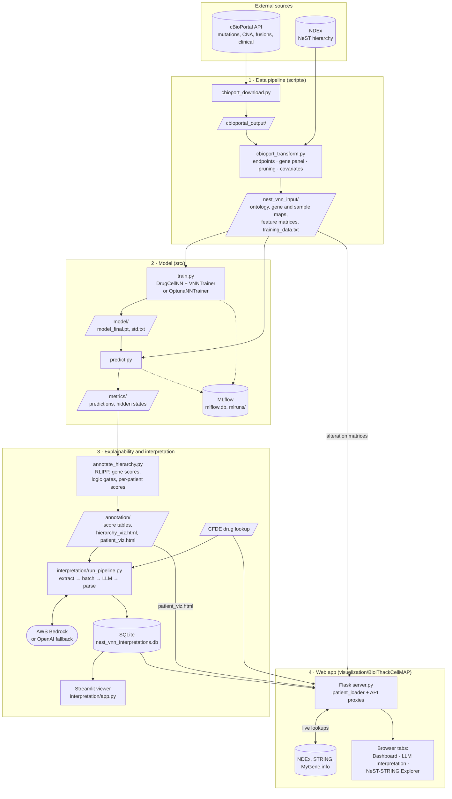
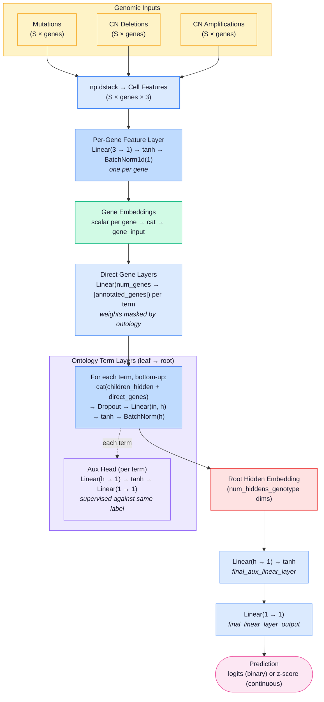

# NeST-VNN: interpretable outcome prediction for cancer patients

NeST-VNN is a visible neural network that predicts clinical outcomes (survival, recurrence, drug response) from tumor genotype. Its structure follows the NeST hierarchy of protein assemblies: every system in the hierarchy becomes a small group of PyTorch modules. That makes each prediction traceable to the biological systems and genes behind it, rather than to individual weights.

Each patient or sample is described by binary per-gene features for a gene panel that overlaps the NeST map: somatic mutations, copy-number deletions, copy-number amplifications and, optionally, gene fusions. Clinical covariates such as sample type or mutation count can be added as extra inputs.

This repo was built at the Bio-IT World hackathon. On top of [idekerlab/nest_vnn](https://github.com/idekerlab/nest_vnn) it adds:
- a cBioPortal data pipeline
- clinical covariates
- per-patient explainability
- LLM-written interpretations
- a web dashboard

**Related publications** (please cite both if you use this repo):
1. Park, S., Silva, E., Singhal, A. et al. A deep learning model of tumor cell architecture elucidates response and resistance to CDK4/6 inhibitors. *Nat Cancer* (2024). https://doi.org/10.1038/s43018-024-00740-1
2. Zhao, Singhal, et al. Cancer mutations converge on a collection of protein assemblies to predict resistance to replication stress. *Cancer Discov* 14(3):508–523 (2024). https://doi.org/10.1158/2159-8290.CD-23-0641

## Demo, video and slides

- **Live demo:** https://d1zrqe6xve7yby.cloudfront.net
- **Presentation:** [NeST-VNN on Genially](https://view.genially.com/6a0ba1856731f1a27bb6d625)
- **Video walkthrough:** covers the whole pipeline, from data download through training and annotation to the dashboard.

[](https://youtu.be/bjEPVhkSdC0)

## Contents

- [System overview](#system-overview)
- [Repository layout](#repository-layout)
- [Environment setup](#environment-setup)
- [Running the pipeline](#running-the-pipeline)
- [Output files and how to read them](#output-files-and-how-to-read-them)
- [How the model works](#how-the-model-works)
- [Reference run](#reference-run)
- [LLM interpretation](#llm-interpretation)
- [Web app](#web-app)

## System overview

The project has four parts that hand data to each other through files:

1. **Data pipeline.** Pulls a study from cBioPortal and a hierarchy from NDEx, and turns them into model inputs.
2. **Model.** Trains the ontology-shaped network, predicts, and records every system's and gene's hidden state.
3. **Explainability and interpretation.**
   - Scores each system and gene for the whole cohort and for each patient.
   - Asks an LLM to write a summary per patient, which is stored in SQLite.
4. **Web app.** Serves the results in three tabs, and calls NDEx, STRING and MyGene.info live.



The live demo runs only the web app, on an AWS Lightsail VM: CloudFront (HTTPS) → nginx → gunicorn → `server.py`. The data it serves is the bundled reference run and interpretation database; nothing is trained on the server.

## Repository layout

| Path | Contents |
|---|---|
| `bioitworld_nest_vnn/scripts/` | cBioPortal download and transform, plus the interactive launcher `run.py` |
| `bioitworld_nest_vnn/src/` | Model, training, prediction and annotation code |
| `bioitworld_nest_vnn/interpretation/` | LLM interpretation pipeline, Streamlit viewer, and the SQLite results |
| `bioitworld_nest_vnn/data/` | Default gene list and ontology, plus all run outputs under `data/output/` |
| `bioitworld_nest_vnn/data/output/breast_msk_2025/` | A complete reference run: inputs, trained model, annotations |
| `bioitworld_nest_vnn/mlruns/`, `mlflow.db` | MLflow tracking data for the reference run |
| `visualization/BioiThackCellMAP/` | Flask web app: dashboard, LLM interpretations, NeST-STRING explorer |
| `docs/` | Architecture diagrams |

## Environment setup

```bash
cd bioitworld_nest_vnn
conda env create -f conda-envs/environment.yml
conda activate nest_vnn
```

This installs Python 3.12 and PyTorch 2.10. A CUDA GPU makes training faster, but training and prediction also run on CPU: pass `-cuda cpu`, or pick `cpu` when the launcher asks. `requirements.txt` also installs two optional packages: `ndex2`, which the annotation step needs to write CX2 files, and `mlflow`, for experiment tracking.

On Windows, set this before running anything:

```powershell
$env:PYTHONUTF8=1
```

Without it, `cbioport_transform.py` crashes with a `UnicodeEncodeError` when it writes its README (the `≥` character can't be encoded in cp1252). Pressing Ctrl+C during the transform on Windows prints `FileNotFoundError: stty sane`. That is `run.py` trying to reset a Unix terminal, and it can be ignored.

## Running the pipeline

All commands run from `bioitworld_nest_vnn/`. Outputs go to `data/output/<study_id>/`, with one subfolder per label: `data/output/<study_id>/<label>/`.

```
cBioPortal → cbioport_download.py → cbioportal_output/
  → cbioport_transform.py → nest_vnn_input/
    → train.py → <label>/model/
      → predict.py → <label>/metrics/
        → annotate_hierarchy.py → <label>/annotation/
          → interpretation/ (LLM summaries) and the web app
```

### Interactive launcher

```bash
python scripts/run.py
```

The launcher offers these steps:
- Download from cBioPortal
- Transform to NeST-VNN
- Train
- Predict + Annotate
- Predict
- Annotate
- Download sample data

At each step it lists the studies and labels already on disk and shows every parameter with its default. It reads `endpoints.json` to decide whether a label is binary or continuous. **Predict + Annotate** runs both steps in a row, and can log the annotation files to the prediction's MLflow run.

### Step by step

**1. Download a study from cBioPortal**

```bash
python scripts/cbioport_download.py breast_msk_2025
```

This writes mutations, copy number, fusions and clinical data to `data/output/<study_id>/cbioportal_output/`.

**2. Transform it into model inputs**

```bash
python scripts/cbioport_transform.py breast_msk_2025
```

The transform asks you four things:

1. **Endpoints.** Pick one or more clinical attributes to predict. Numeric ones can be used as continuous labels, as binary labels (values above a threshold you enter become 1), or both. Categorical ones get a binary mapping you confirm.
2. **Gene panel and hierarchy.** Either use the default `data/gene2ind.txt` and `data/ontology.txt`, or build both from an NDEx hierarchy (the NeST map by default, UUID `9a8f5326-aa6e-11ea-aaef-0ac135e8bacf`). With NDEx, the genes come from one of two sources:
   - **by frequency:** genes altered in at least X% of the cohort. The script shows how many genes each cutoff keeps.
   - **from a file:** a gene list with one symbol per line.
3. **Pruning.** When building from NDEx, systems with fewer than the minimum number of panel genes (default 5, as in the NeST-VNN paper) are removed. Their genes move up to the nearest remaining parent.
4. **Covariates (optional).** Clinical attributes to feed into the model as extra inputs:
   - **Numeric** ones, such as `MUTATION_COUNT` or `FRACTION_GENOME_ALTERED`, are z-scored.
   - **Categorical** ones, such as `SAMPLE_TYPE`, get an integer mapping that you confirm, e.g. `Metastasis=1, Primary=0`.

   Each becomes a `cov_<name>` column in `training_data.txt`, and its encoding is saved to `covariate_stats.json`.

Everything is written to `data/output/<study_id>/nest_vnn_input/`, including `metadata.json`, which records the cBioPortal study and the NDEx network used. Some prompts can be skipped with flags:

| Flag | Effect |
|---|---|
| `--endpoints-json FILE` | Read the endpoint choices from a JSON file instead of asking |
| `--ndex-uuid UUID` | Build from this NDEx hierarchy without asking |
| `--min-alt-freq F` | Frequency cutoff (0–1) for gene selection with `--ndex-uuid`; default 0.01 |
| `--gene-list FILE` | Use this gene list with `--ndex-uuid` |
| `--min-genes N` | Minimum panel genes per system when building from NDEx; default 5 |
| `--data-dir DIR` | Base data folder; default `data` |

**3. Train**

```bash
S=data/output/breast_msk_2025/nest_vnn_input
M=data/output/breast_msk_2025/binary_os_months/model
python src/train.py -onto $S/ontology.txt -gene2id $S/gene2ind.txt -cell2id $S/cell2ind.txt \
  -train $S/training_data.txt -mutations $S/cell2mutation.txt \
  -cn_deletions $S/cell2cndeletion.txt -cn_amplifications $S/cell2cnamplification.txt \
  -label binary_os_months -task binary -std $M/std.txt -modeldir $M -cuda cpu
```

- **Task:** use `-task binary` for classification and `-task continuous` for regression.
- **Fusions:** add `-fusions $S/cell2fusion.txt` to include them.
- **Covariates:** any `cov_*` columns in `training_data.txt` are used automatically.
- **Output:** the checkpoint with the lowest validation loss is saved as `<label>/model/model_final.pt`.
- **MLflow:** tracking is on by default, under the `nest_vnn` experiment; pass `-no_mlflow` to turn it off.

All training flags are listed under [Training flags](#training-flags).

**4. Predict**

```bash
R=data/output/breast_msk_2025/binary_os_months
python src/predict.py -predict $S/training_data.txt -gene2id $S/gene2ind.txt -cell2id $S/cell2ind.txt \
  -mutations $S/cell2mutation.txt -cn_deletions $S/cell2cndeletion.txt \
  -cn_amplifications $S/cell2cnamplification.txt -label binary_os_months -task binary \
  -std $R/model/std.txt -load $R/model/model_final.pt \
  -hidden $R/metrics/hidden -result $R/metrics/predict -cuda cpu
```

This writes predictions to `<label>/metrics/`, plus the hidden state of every system and gene to `metrics/hidden/`. Note that `-predict` here is the full `training_data.txt`, training samples included.

**5. Annotate**

```bash
python src/annotate_hierarchy.py breast_msk_2025 -label binary_os_months -task binary -cpu_count 4
```

The annotation step finds the hidden states, predictions and labels from the study and label, so no paths are needed. It writes the explainability files and both HTML viewers to `<label>/annotation/`.

### Sample data (no cBioPortal needed)

Choose **Download sample data** in `run.py`. It downloads the original GDSC drug-response dataset from [idekerlab/nest_vnn](https://github.com/idekerlab/nest_vnn): 1,244 cell lines, 718 genes and the NeST ontology. The data is set up under `data/output/nest_vnn_sample/nest_vnn_input/`.

## Output files and how to read them

A run writes everything under `data/output/<study_id>/<label>/`. This section lists those files and explains the scores in them.

One caveat applies to every score here. RLIPP, gene scores and subsystem weights are all computed against the model's own predictions, not the true labels. They describe what the model has learned to rely on. If the model predicts poorly, the scores describe a poor model, so check its accuracy before drawing biological conclusions.

### Files

#### `model/`

| File | Contents |
|---|---|
| `model_final.pt` | Checkpoint with the lowest validation loss |
| `std.txt` | Label normalization parameters, reused at prediction time |

#### `metrics/`

| File | Contents |
|---|---|
| `predict.txt` | Raw output: logits for binary tasks, z-scores for continuous ones |
| `predict_probabilities.txt` | Sigmoid probabilities (binary only) |
| `predict_predictions.txt` | Predictions thresholded at 0.5 (binary only) |
| `hidden/<term>.hidden` | Hidden state of each NeST system, samples × hidden units |
| `hidden/<gene>.hidden` | Hidden state of each gene, samples × 1 |

#### `annotation/`

Cohort-level scores:

| File | Contents |
|---|---|
| `rlipp_scores.txt` | RLIPP score for each system |
| `top_systems.txt` | The 20 systems with the highest RLIPP |
| `gene_scores.txt` | Correlation of each gene with the prediction |
| `subsystem_gene_weights.txt` | For each system, its genes ranked by how much they drive it |
| `top_subsystem_genes.txt` | Top 5 driving genes for each of the 20 highest-RLIPP systems |
| `boolean_logic.txt` | Best-fitting logic gate for pairs of child systems |

Per-patient scores (each a samples × terms or samples × genes table):

| File | Contents |
|---|---|
| `patient_term_importance.txt` | How unusual each system's activity is for that patient |
| `patient_term_mean_z.txt` | Signed version of the above, used to show direction |
| `patient_rlipp.txt` | Patient-level RLIPP |
| `patient_gene_importance.txt` | Absolute z-score of each gene's hidden state |
| `patient_gene_signed_z.txt` | Signed z-score of each gene's hidden state |

Viewers and graph exports:

| File | Contents |
|---|---|
| `hierarchy_viz.html` | Browsable hierarchy with all cohort scores; opens in any browser |
| `patient_viz.html` | Per-patient viewer; also the data source for the web app |
| `hierarchy_annotated.graphml` | Annotated hierarchy for Cytoscape |
| `hierarchy_annotated.cx2` | The same for NDEx and Cytoscape Web (needs `ndex2`) |

### RLIPP scores (`rlipp_scores.txt`)

RLIPP asks whether a system adds predictive signal beyond what its child systems already carry.

For each system, the annotation step reduces its hidden state with PCA, fits a ridge regression against the model's predictions, and takes the Spearman correlation of the fit (`p_rho`). It then does the same with the combined hidden states of the system's children (`c_rho`). RLIPP is `p_rho / c_rho`. It is set to 0 when `c_rho` is close to zero.

| Column | Meaning |
|---|---|
| `term` | System ID, e.g. `NEST:38` |
| `rlipp` | `p_rho / c_rho` |
| `p_rho`, `p_pval` | Correlation of the system's own hidden state with the prediction, and its p-value |
| `c_rho`, `c_pval` | The same for its children combined |

How to read it:

- **Above 1:** the system carries signal its children don't. These are the systems the model leans on at that level of the hierarchy.
- **About 1:** the children already explain it.
- **Below 1:** the children predict better than the parent. The parent may just be summarizing them.

A high `p_rho` with a small `p_pval` means the system's activity tracks the prediction reliably across patients.

### Gene scores (`gene_scores.txt`)

Each gene's hidden state is a single number per patient. `rho` is the Spearman correlation of that number with the model's predictions, and `p_val` is its p-value. A positive `rho` means higher activation goes with a higher predicted outcome. Rows are sorted by `|rho|`.

### Subsystem gene weights (`subsystem_gene_weights.txt`)

For each system, this file ranks the genes annotated to it. It does this by correlating each gene's hidden state with the first principal component (PC1) of the system's hidden state.

| Column | Meaning |
|---|---|
| `term`, `gene` | System and gene |
| `pc1_corr`, `pc1_corr_pval` | Spearman correlation with the system's PC1, and its p-value |
| `rank` | Rank within the system by `|pc1_corr|` (1 = strongest) |

The sign shows whether the gene pushes the system along its main direction of variation or against it. `top_subsystem_genes.txt` lists the top 5 genes for the 20 highest-RLIPP systems. The same genes appear as "Key driving genes" in `hierarchy_viz.html`.

### Boolean logic (`boolean_logic.txt`)

This file describes how a parent system combines two of its child systems, following Ma et al. 2018 (DCell).

For every parent with at least two child systems, each pair of children (A, B) is tested:

1. Each system's activity is set to on or off, depending on whether its PC1 is above the cohort median.
2. For each of the four (A, B) combinations, the parent's majority state is recorded.
3. That truth table is matched against the 10 non-trivial two-input gates below.

A pair is only scored if each of the four combinations covers at least 4 samples and no more than half of all samples.

| Column | Meaning |
|---|---|
| `parent`, `child1`, `child2` | The three systems |
| `logic` | Best-matching gate |
| `consistency` | Share of samples where the gate predicts the parent's state correctly |
| `n_samples` | Samples used |

| Gate | Parent is on when | Reading |
|---|---|---|
| `AND` | both A and B are on | both are required |
| `OR` | A or B is on | either one is enough |
| `XOR` | exactly one is on | they are mutually exclusive |
| `NAND` | not both are on | turning both on shuts the parent off |
| `NOR` | neither is on | either one shuts the parent off |
| `XNOR` | both are on, or both are off | the parent follows their agreement |
| `A_NOT_B` | A is on and B is off | A drives it, B inhibits it |
| `B_NOT_A` | B is on and A is off | B drives it, A inhibits it |
| `A_OR_NOT_B` | any state except B on alone | |
| `B_OR_NOT_A` | any state except A on alone | |

Treat consistency of 0.70 or more as a good fit, 0.60–0.70 as moderate, and below 0.60 as noise. The gates describe patterns in the model's learned representations, not biochemical mechanisms. They are most meaningful for high-RLIPP systems. They also depend on the median cutoff used in step 1.

### Hierarchy viewer (`hierarchy_viz.html`)

Open the file in a browser; it needs no server. Pick a system from the table to see:

- its RLIPP, `p_rho`, `p_pval`, `c_rho` and `c_pval`
- its parent and child systems, which are clickable
- its key driving genes, from `subsystem_gene_weights.txt`
- its logic-gate fits with its children, colored by consistency, with an in-page explanation under **? help**
- genes annotated directly to it, and genes it inherits from its children, each with its gene-level `rho`

The table can be sorted, filtered and searched.

### Patient viewer (`patient_viz.html`)

Pick a patient by ID. The page has three parts.

#### Summary bar

- **Prediction:** for binary tasks, the predicted probability is labeled high (≥ 0.7), moderate-high (≥ 0.5), moderate-low (≥ 0.3) or low. For continuous tasks, the score is shown relative to the cohort mean.
- **Top system:** the patient's most important system and its cohort RLIPP. It is marked "cohort-validated" if that RLIPP is above 1.2.
- **Top gene:** the most important gene with a clear direction (|z| ≥ 0.8 and |cohort `rho`| ≥ 0.1). For example: "TP53 (z=+2.1, cohort ρ=+0.41) → higher".

#### Systems panel

Every system, ranked by importance for this patient:

| Column | Meaning |
|---|---|
| Importance | Length of the patient's z-scored hidden state for the system, i.e. how far it sits from the cohort average. Raw activations are nearly the same for everyone because of batch normalization, so z-scoring is needed to see differences. |
| Pt-RLIPP | The system's squared deviation divided by the sum of its children's. Above 1 means the system is more unusual than its children explain. |
| Pop-RLIPP | The cohort RLIPP from `rlipp_scores.txt` |
| Outcome Dir | sign(mean z across hidden units) × sign(cohort `p_rho`). Shown only when \|mean z\| ≥ 0.2 and \|`p_rho`\| ≥ 0.1. |

#### Genes panel

The patient's 100 most important genes:

| Column | Meaning |
|---|---|
| Importance | \|z-score\| of the gene's hidden state |
| Signed Z | The same z-score with its sign: above or below the cohort average |
| Outcome Dir | sign(signed z) × sign(cohort `rho`). "↑ higher" (orange) means the deviation points toward a higher predicted score; "↓ lower" (green) means the opposite. Shown only when \|z\| ≥ 0.5 and \|cohort `rho`\| ≥ 0.1, otherwise "—". |

Both direction columns are rough guides, not causal claims. They combine a cohort-wide correlation with one patient's deviation and assume the relationship is monotone. The system version also reduces a multi-dimensional state to its mean. Projecting onto the ridge regression direction would be more principled. Use them to generate hypotheses.

## How the model works

This section covers how the network is built, how it is trained, the training flags, the code layout and the input file formats.

### How the network is built

`DrugCellNN` (an `nn.Module` in `src/drugcell_nn.py`) builds its layers from the ontology at startup. The hierarchy has two kinds of edges: system-to-system edges and gene-to-system annotations. Every module is named after its gene or system, so a layer can be found by name, e.g. `NEST:38_linear_layer`.

**Gene layer.** Each gene has one to four binary inputs: mutation, copy-number deletion, copy-number amplification and, optionally, fusion. The feature tensor is `(n_cells, n_genes, n_features)`. A small per-gene layer turns them into one number per gene:

```
<gene>_feature_layer: Linear(n_features → 1) → tanh → <gene>_batchnorm_layer: BatchNorm1d(1)
```

Batch normalization keeps one feature type from dominating the others.

**System layers.** `construct_NN_graph` builds the systems from the leaves up to the root. Each system takes two inputs:
- the hidden states of its child systems
- the outputs of its direct gene layer, `<term>_direct_gene_layer`

These are concatenated and go through the layers below to produce a hidden state of size `-genotype_hiddens` (default 4):

```
<term>_dropout_layer → <term>_linear_layer → tanh → <term>_batchnorm_layer
```

The dropout layer is added only from `-min_dropout_layer` upward.

**Ontology constraint.** Each system's direct gene layer is `Linear(n_genes → number of annotated genes)`: it reads every gene, but only its annotated genes are allowed to have weight. `term_direct_gene_map` records which genes those are, and `util.create_term_mask` turns it into a mask. At startup, weights outside each system's gene set are zeroed. After every backward pass, their gradients are zeroed too:

```python
param.grad.data = torch.mul(param.grad.data, term_mask_map[term_name])
```

So a gene can only feed a system it is annotated to. This is what makes a system's activity interpretable as the state of its genes. The masking happens in `vnn_trainer.py`; the weight matrices themselves are not sparse. All weights are also scaled by 0.1 at startup.

**Auxiliary outputs.** Every system has a small output head, trained against the same label as the final output:

```
<term>_aux_linear_layer1: Linear(h → 1) → tanh → <term>_aux_linear_layer2: Linear(1 → 1)
```

The training loss is:

```
total_loss = main_loss + alpha * sum(aux_loss over all systems)
```

`alpha` defaults to 0.3. With these heads, gradient reaches every level of the hierarchy at each step, not only the path from the root down. Without them, systems far from the root get little gradient and learn little.

**Output.** The root's hidden state goes through the final layers to give the prediction:

```
final_aux_linear_layer: Linear(h → 1) → tanh → final_linear_layer_output: Linear(1 → 1)
```

`forward` returns `(aux_out_map, hidden_embeddings_map)`:
- `aux_out_map` holds the auxiliary outputs, keyed by system name, with the final prediction under `'final'`.
- `hidden_embeddings_map` holds the hidden state of every system and gene. `predict.py` writes these to `metrics/hidden/`.

#### Genotype only



#### With clinical covariates

Covariates are the `cov_*` columns that `cbioport_transform.py` adds to `training_data.txt`; `TrainingDataWrapper` picks them up automatically. A clinical encoder, `Linear(n_cov → h) → tanh → BatchNorm`, brings them to the same size as the root's hidden state. The two are concatenated before the final layers. The ontology layers never see the covariates.


| Step | Layer | Input | Output |
|---|---|---|---|
| 1 | `np.dstack` of the feature matrices | 3–4 × (S × genes) | S × genes × features |
| 2 | Per-gene `Linear → tanh → BatchNorm` | S × features, per gene | S × 1, per gene |
| 3 | Concatenate gene outputs | | S × genes |
| 4 | Direct gene layer, per system | S × genes | S × annotated genes |
| 5 | System layers, leaves to root | S × (children's h + direct genes) | S × h |
| 5a | Auxiliary head, per system | S × h | S × 1, used only in the loss |
| 6 | Clinical encoder | S × n_cov | S × h |
| 7 | Concatenate root and clinical | S × h, S × h | S × 2h |
| 8 | `Linear(2h → 1) → tanh` | S × 2h | S × 1 |
| 9 | `Linear(1 → 1)` | S × 1 | S × 1 |

S is the batch size and h is `-genotype_hiddens`.

### Binary and continuous tasks

The network is the same for both. Only the loss and the output handling change.

| | Binary (`-task binary`) | Continuous (`-task continuous`) |
|---|---|---|
| Loss (main and auxiliary) | `BCEWithLogitsLoss` | `MSELoss` |
| Label normalization | None, labels stay 0/1 | Set by `-zscore_method`, see below |
| Prediction output | Logits, then sigmoid, then a 0.5 threshold | Normalized predictions, which can be converted back using `std.txt` |
| Reported metric | Accuracy | Pearson correlation |

For continuous labels, `-zscore_method zscore` or `robustz` normalizes them using training-set statistics and saves the parameters to `std.txt`. The default, `auc`, leaves labels as they are, which suits labels already on a common scale. Prediction always reads `std.txt`, so passing `-zscore_method` to `predict.py` has no effect.

The original NeST-VNN used concordance correlation (CCC) as the auxiliary loss for regression. This version uses MSE instead. Early in training the auxiliary heads output nearly constant values, which makes CCC's denominator close to zero and the loss unstable. MSE has no such problem.

### Training

- **Split:** 20% of samples are held out at random for validation; `-seed` makes the split repeatable. There is no separate test split. `run.py` runs prediction on the whole of `training_data.txt`, training samples included.
- **Optimization:** AdamW with gradient clipping (max norm 5.0). Training stops early when validation loss hasn't improved for `-patience` epochs, and the best checkpoint is kept as `model_final.pt`.
- **Hyperparameter search:** `-optimize 2` runs 20 Optuna trials before the final training run.
- **Architecture images:** each run writes `nn_architecture.png` (the actual network, drawn from the ontology) and `nn_schematic.png` (a simplified overview) to the model folder.
- **MLflow:** on by default, under the `nest_vnn` experiment; `-no_mlflow` turns it off. A training run logs:
  - its parameters
  - every epoch: `train_loss`, `val_loss`, `train_<metric>`, `val_<metric>` and `grad_norm`, where the metric is `accuracy` for binary tasks and the Pearson correlation for continuous ones
  - the best epoch so far: `best_epoch`, `best_train_loss`, `best_val_loss`, `best_train_<metric>`, `best_val_<metric>`
  - for binary tasks: confusion-matrix counts (`<split>_cm_tn`, `_fp`, `_fn`, `_tp`) and images (`confusion_matrix_<split>.png`) for the train and validation sets
  - the best model, with an input and output signature. If logging the model fails, it falls back to `model_final.pt` as a plain artifact.

  `predict.py` logs `test_accuracy` (binary) or `test_pearson_r` (continuous), as a child run of the training run, on whatever file it is given, so it is only a test score if that file holds unseen samples.

#### Training flags

| Flag | Default | Meaning |
|---|---|---|
| `-task` | `continuous` | `binary` or `continuous` |
| `-label` | none | Column of `training_data.txt` to predict |
| `-genotype_hiddens` | `4` | Hidden units per system; the annotation step reads it from the hidden files |
| `-optimize` | `1` | `1` trains directly; `2` runs an Optuna search first |
| `-alpha` | `0.3` | Weight of the auxiliary losses |
| `-epoch` | `300` | Maximum epochs (`run.py` suggests 200) |
| `-lr` | `0.001` | AdamW learning rate |
| `-wd` | `0.001` | AdamW weight decay |
| `-patience` | `30` | Epochs without improvement before stopping |
| `-dropout_fraction` | `0.3` | Dropout on system layers |
| `-min_dropout_layer` | `2` | First layer, counting from the leaves, that gets dropout |
| `-zscore_method` | `auc` | Label normalization for training: `auc` (none), `zscore` or `robustz` |
| `-cuda` | `0` | GPU index, or `cpu` |
| `-seed` | none | Seed for the train/validation split |
| `-no_mlflow` | off | Turn off MLflow tracking |

### Code layout

`src/`:

| File | Role |
|---|---|
| `drugcell_nn.py` | `DrugCellNN`, the network; `construct_NN_graph` builds the system layers |
| `training_data_wrapper.py` | `TrainingDataWrapper`. Loads the ontology into a networkx `DiGraph` and checks it has one root and is connected. Builds `term_direct_gene_map` and `term_size_map`, stacks the feature matrices into `(n_cells, n_genes, n_features)`, reads the `cov_*` columns, and makes the 80/20 train/validation split. |
| `vnn_trainer.py` | `VNNTrainer`: training loop, gradient masking, early stopping, MLflow logging, architecture images |
| `optuna_nn_trainer.py` | `OptunaNNTrainer`, a subclass of `VNNTrainer` that runs 20 Optuna trials |
| `train.py` | Command-line entry point. Builds the `TrainingDataWrapper`, then runs `VNNTrainer` (`-optimize 1`) or `OptunaNNTrainer` (`-optimize 2`) |
| `predict.py` | Loads a model and writes predictions, hidden states and gradients. Reports accuracy (binary) or Pearson correlation (continuous) |
| `annotate_hierarchy.py` | `ClinicalRLIPPCalculator`: RLIPP, gene scores, subsystem weights, logic gates, per-patient scores and the HTML viewers |
| `rlipp_calculator.py`, `rlipp_helper.py` | Older RLIPP code that groups results by drug, for the GDSC sample data |
| `util.py` | Shared helpers: data loading (`load_train_data`, `load_pred_data`), label normalization (`calc_std_vals`, `standardize_data`), input building (`build_input_vector`), gene masks (`create_term_mask`) and correlations (`pearson_corr`, `spearman_corr`) |

`scripts/`:

| File | Role |
|---|---|
| `cbioport_download.py` | Downloads mutations, copy number, fusions and clinical data for a cBioPortal study |
| `cbioport_transform.py` | Builds the model inputs: you choose the endpoint, the gene panel (by mutation frequency, or from an NDEx hierarchy) and the covariates |
| `run.py` | Interactive launcher for all of the above |

When an NDEx hierarchy is used, systems with fewer than 5 panel genes (the default, as in the paper) are removed. Their genes move up to the nearest remaining parent.

### Input files

All of these live in `data/output/<study_id>/nest_vnn_input/`.

| File | Format | Contents |
|---|---|---|
| `ontology.txt` | TSV: `parent child relation` | `relation` is `default` for a system-to-system edge, `gene` for a gene annotation |
| `cell2ind.txt` | TSV: `index sample_id` | Sets the row order of the feature matrices |
| `gene2ind.txt` | TSV: `index gene_symbol` | Sets the column order of the feature matrices |
| `cell2mutation.txt`, `cell2cndeletion.txt`, `cell2cnamplification.txt`, `cell2fusion.txt` | CSV of 0/1 | Samples × genes |
| `training_data.txt` | TSV with header | `cell_line`, one or more label columns, any `cov_*` columns, and `dataset`. The older headerless format is `cell_line smiles auc dataset`. |
| `endpoints.json` | JSON | Whether each label is binary or continuous; `run.py` uses it to pick the task |
| `covariate_stats.json` | JSON | How each `cov_*` column was encoded (mean and std for numeric columns, a value map for categorical ones), so values can be shown in readable form |
| `metadata.json` | JSON | The cBioPortal study and NDEx network the inputs came from |

## Reference run

`data/output/breast_msk_2025/binary_os_months/` holds a complete run on MSK-IMPACT breast cancer data from cBioPortal (`breast_msk_2025`). These numbers are useful for checking a fresh run.

**Data and transform**

| | |
|---|---|
| Source | 3,879 samples from 3,116 patients; 3,784 unique samples after deduplication |
| Samples with a valid label | 3,777 |
| Gene panel | genes altered in at least 0.5% of samples: 430 genes, 407 of them in the ontology |
| Hierarchy | default NeST from NDEx, minimum 5 genes per system: 103 systems kept of 395 |
| Label | `binary_os_months`: `OS_MONTHS` split at 46 months. Class 0 (deceased) has 2,071 samples; class 1 (living) has 1,706. |

**Training**

| | |
|---|---|
| Parameters | batch size 512, learning rate 0.001, `alpha` 0.3, patience 30, dropout 0.3, 4 hidden units per system |
| Shipped model | MLflow run `7e4613e8`: best validation loss at epoch 142, early stop at epoch 172 |
| Validation accuracy | 0.69, on a random 20% of samples held out during training |

There is no separate test set. The predictions in `metrics/` cover all samples, training ones included; their accuracy, 0.71, is not a test score.

**Annotation**

| | |
|---|---|
| Scale | 103 systems, 407 genes, 3,777 samples |
| Logic gates | 51 parent–child trios fit a gate. The most common are `B_NOT_A` (16), `A_NOT_B` (10) and `NOR` (8). |

The highest-RLIPP systems are listed in `annotation/top_systems.txt`.

The MLflow database stores absolute artifact paths from the machine the run was made on, which was Windows. To browse the runs elsewhere, repoint them:

```sql
-- sqlite3 bioitworld_nest_vnn/mlflow.db
UPDATE runs SET artifact_uri = REPLACE(artifact_uri, 'file:C:/Users/prath/OneDrive/Desktop/cellmapvnn', 'file:///Users/<you>/cellmapvnn');
```

## LLM interpretation

`interpretation/` turns each patient's results into a plain-language clinical summary. For each patient it:

1. collects the top systems and genes from the annotation files
2. sends them to an LLM in batches
3. parses the reply into structured fields
4. stores them in `interpretation/nest_vnn_interpretations.db`

Only results with a clear direction go into the prompt:
- **Systems:** up to 3 per patient, needing |mean z| ≥ 0.2 and |cohort `p_rho`| ≥ 0.1.
- **Genes:** up to 3 per system, needing |signed z| ≥ 0.5 and |cohort `rho`| ≥ 0.1.

These are the same rules the Explorer uses for its direction arrows.

| File | Role |
|---|---|
| `extractor.py` | Collects per-patient records: systems, genes, alteration types, covariates |
| `prompts.py` | System prompt and batch message builder |
| `llm_client.py` | Calls AWS Bedrock first and falls back to OpenAI |
| `pipeline.py` | Runs extract → batch → LLM → parse → store |
| `db.py` | SQLite schema: `patients`, `patient_nests`, `patient_genes` |
| `cfde_drugs.py`, `cfde_drug_lookup.json` | Drug annotations from the CFDE IDG druggable-genome data |
| `app.py` | Streamlit viewer for the stored results |

Install `interpretation/requirements.txt`, then set credentials. For OpenAI, set `OPENAI_API_KEY`. For Bedrock, set `AWS_ACCESS_KEY_ID`, `AWS_SECRET_ACCESS_KEY` and `AWS_REGION`.

```bash
# first run
python interpretation/run_pipeline.py breast_msk_2025 binary_os_months --limit 200

# redo patients already in the database
python interpretation/run_pipeline.py breast_msk_2025 binary_os_months --limit 200 --no-skip

# resume after a failure, skipping the first 155 patients
python interpretation/run_pipeline.py breast_msk_2025 binary_os_months --limit 200 --offset 155 --no-skip

# browse the results
streamlit run interpretation/app.py
```

`--batch-size` sets how many patients go into each LLM call (default 5).

The bundled database holds 200 patients. They were written by OpenAI GPT-4o because the Bedrock credentials had expired, and the text was reviewed by hand for biological plausibility. The first run stopped at patient 155 on an OpenAI quota limit and was finished with `--offset 155`.

## Web app

`visualization/BioiThackCellMAP/` is a Flask app (port 5001) with three tabs. Each tab is its own HTML page in an iframe:

| Tab | Page | Shows | Data |
|---|---|---|---|
| Dashboard | `static/dashboard.html` | Cohort overview: patient counts, outcome by risk class, the systems and genes that come up most often | Interpretation database |
| LLM Interpretation | `static/interpretation.html` | Per-patient summaries, plus gene tables with alteration badges and CFDE drug annotations | Interpretation database |
| NeST-STRING Explorer | `static/explorer.html` | The NeST map colored by RLIPP, STRING protein interactions for a selected system, and each patient's altered genes and their direction | `patient_viz.html`, plus live NDEx, STRING and MyGene.info |

```bash
cd visualization/BioiThackCellMAP
pip install flask flask-cors requests
python server.py   # http://localhost:5001
```

At startup, `server.py` loads two kinds of data:
- the most recently modified `patient_viz.html` under `bioitworld_nest_vnn/data/output/` or `mlruns/`, plus the alteration matrices from that study's `nest_vnn_input/`
- the interpretation database

The server also proxies NDEx, STRING and MyGene.info so the browser doesn't run into CORS errors. If the database is missing, the Dashboard and LLM Interpretation tabs show an empty state.
