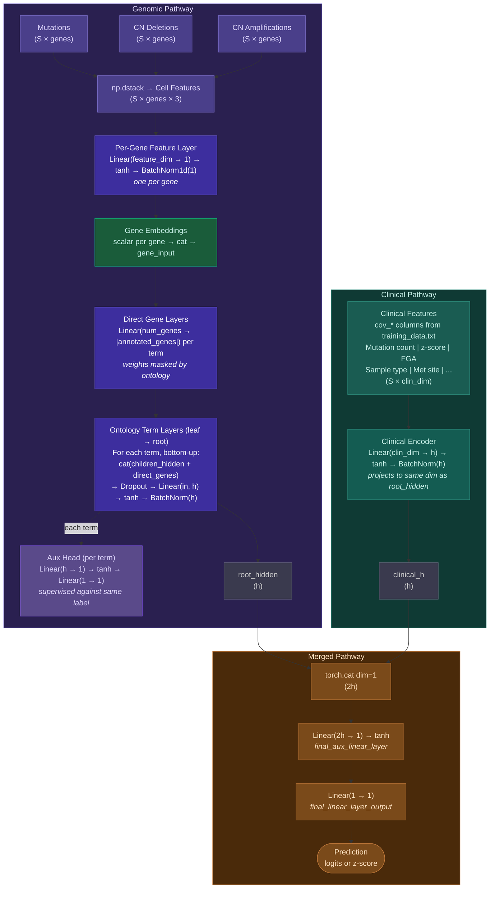

# NeST-VNN: Interpretable Neural Network for Cancer Clinical Outcomes

NeST-VNN is an interpretable neural network that predicts cancer patient clinical outcomes (survival, recurrence, drug response) from tumor genotype. Its structure mirrors a hierarchical biological ontology — each node in the hierarchy becomes a group of PyTorch modules — making predictions explainable at the level of biological systems rather than individual genes.

Each patient/sample is characterized by binary feature vectors for somatic mutations, copy number deletions, copy number amplifications, and (optionally) gene fusions for a selected gene set/panel that overlaps with a cell map.

**Related publications (please cite both if you use this repo):**
1. Park, S., Silva, E., Singhal, A. et al. *A deep learning model of tumor cell architecture elucidates response and resistance to CDK4/6 inhibitors.* Nat Cancer (2024). https://doi.org/10.1038/s43018-024-00740-1
2. Zhao, Singhal, et al. *Cancer Mutations Converge on a Collection of Protein Assemblies to Predict Resistance to Replication Stress.* Cancer Discov 14 (3): 508–523 (2024). https://doi.org/10.1158/2159-8290.CD-23-0641

---

## Demo

Watch a full walkthrough of the pipeline — from data download through training, annotation, and the interactive visualization dashboard — on YouTube:

[](https://youtu.be/bjEPVhkSdC0)

---

## Environment setup

A CUDA-capable GPU is recommended. CPU-only training and inference is also supported (pass `-cuda cpu` or select `cpu` when prompted).

```bash
conda env create -f conda-envs/environment.yml
conda activate nest_vnn
```

`ndex2` is an optional dependency that enables CX2 output in the annotation step (already included in `requirements.txt`). `mlflow` is also optional and enables experiment tracking.

---

## End-to-end workflow

All commands are run from the repository root. Outputs land in `data/output/<study_id>/<label>/`.

### Interactive launcher (recommended)

```bash
python scripts/run.py
```

Presents a menu to download, transform, train, predict+annotate, or download sample data. Lists available studies and labels at each step, shows parameters with defaults, and handles task type (binary/continuous) automatically from `endpoints.json`.

### Step-by-step using bash scripts

**1. Download genomic + clinical data from cBioPortal**

```bash
python scripts/cbioport_download.py <study_id>
# e.g. python scripts/cbioport_download.py breast_msk_2025
```

Downloads mutations, copy number, fusion, and clinical data into `data/output/<study_id>/cbioportal_output/`.

**2. Transform to NeST-VNN input format**

```bash
python scripts/cbioport_transform.py <study_id>
```

Interactive: select clinical endpoints (binary or continuous), choose a frequency threshold for the gene panel, and optionally load a custom gene list and ontology from an NDEx network. When using NDEx, assemblies with fewer than the minimum number of panel genes (default: 5, matching the NeST-VNN paper) are pruned and their genes rolled up to the nearest surviving ancestor. Writes all input files to `data/output/<study_id>/nest_vnn_input/`. Also writes `metadata.json` recording the cBioPortal study URL and NDEx network used.

When using `run.py`, you are prompted "Include clinical covariates (e.g. sex, race)?" before the transform runs. If you answer yes, the transform script will prompt you to select which features to include. If you decline, `run.py` passes `--clinical-features none` automatically and the prompt is skipped.

When running `cbioport_transform.py` directly, the transform step prompts whether to include **clinical covariates** as additional input features. If included, the selected features are encoded into `cell2clinical.txt` and automatically passed to train/predict. To skip the prompt, pass `--clinical-features none`. To pre-select features non-interactively:

```bash
python scripts/cbioport_transform.py <study_id> --clinical-features sex,race,mutation_count
```

Available clinical features: `sex`, `race`, `sample_type`, `metastatic_site`, `mutation_count`, `fraction_genome_altered`, `tumor_purity`.

**3. Train**

```bash
bash scripts/train.sh <study_id> <label> <task> [cuda_id] [no_mlflow]
# e.g. bash scripts/train.sh breast_msk_2025 binary_os_status binary 0 no_mlflow
```

- `task`: `binary` for classification, `continuous` for regression
- MLflow experiment tracking is **enabled by default** under the `nest_vnn` experiment. Pass `no_mlflow` as the optional fifth argument to disable it.
- If `cell2clinical.txt` exists in `nest_vnn_input/`, the interactive launcher and shell scripts automatically pass `-clinical` to include clinical covariates as additional per-gene feature layers.

Saves best model (by validation loss) to `data/output/<study_id>/<label>/model/model_final.pt`.

**4. Predict + Annotate**

```bash
bash scripts/predict.sh  <study_id> <label> <task> [cuda_id] [no_mlflow]
bash scripts/annotate.sh <study_id> <label> <task> [cpu_count]
```

Or as a single step via the interactive launcher (`Predict + Annotate` option), which runs both in sequence and optionally logs annotation artifacts to the predict MLflow run. The interactive launcher also auto-detects `cell2clinical.txt` and passes `-clinical` to the predict command, matching the train step behavior.

Predict writes raw outputs and hidden embeddings to `data/output/<study_id>/<label>/metrics/`. Annotate reads those embeddings and writes explainability outputs to `data/output/<study_id>/<label>/annotation/`.

### Sample data (no cBioPortal account needed)

```bash
python scripts/run.py  # → "Download sample data"
```

Downloads the original GDSC drug-response dataset (1,244 cell lines, 718 genes, NeST ontology) from [idekerlab/nest_vnn](https://github.com/idekerlab/nest_vnn) and sets it up under `data/output/nest_vnn_sample/nest_vnn_input/`.

---

## Output files

| Path | Description |
|---|---|
| `<label>/model/model_final.pt` | Best trained model checkpoint |
| `<label>/model/std.txt` | Z-score normalization parameters |
| `<label>/metrics/predict.txt` | Raw model output (logits for binary, z-scores for continuous) |
| `<label>/metrics/predict_probabilities.txt` | Sigmoid probabilities (binary tasks only) |
| `<label>/metrics/predict_predictions.txt` | Thresholded binary predictions (binary tasks only) |
| `<label>/metrics/hidden/<term>.hidden` | Hidden embeddings per ontology term (samples × hidden_dim) |
| `<label>/metrics/hidden/<gene>.hidden` | Hidden embeddings per gene (samples × 1) |
| `<label>/annotation/rlipp_scores.txt` | RLIPP scores per ontology term (cross-cohort) |
| `<label>/annotation/gene_scores.txt` | Gene-level Spearman correlations (cross-cohort) |
| `<label>/annotation/subsystem_gene_weights.txt` | Per-term gene rankings by PC1 correlation — which genes most drive each system's primary axis of variation |
| `<label>/annotation/top_subsystem_genes.txt` | Quick-read summary: top 20 systems × top 5 driving genes |
| `<label>/annotation/boolean_logic.txt` | Boolean logic characterization of child system pairs — AND/OR/XOR/etc. gate fits for parent–child relationships |
| `<label>/annotation/hierarchy_annotated.graphml` | Annotated hierarchy graph (open in Cytoscape) |
| `<label>/annotation/hierarchy_annotated.cx2` | CX2 format for NDEx/Cytoscape Web (requires `ndex2`) |
| `<label>/annotation/hierarchy_viz.html` | Standalone interactive browser visualization |
| `<label>/annotation/top_systems.txt` | Top 20 systems by RLIPP score |
| `<label>/annotation/patient_term_importance.txt` | Per-patient system importance scores (samples × terms) |
| `<label>/annotation/patient_rlipp.txt` | Per-patient RLIPP scores (samples × terms) |
| `<label>/annotation/patient_gene_importance.txt` | Per-patient gene importance — absolute z-score of hidden embedding (samples × genes) |
| `<label>/annotation/patient_gene_signed_z.txt` | Per-patient signed gene z-scores — direction of deviation from population mean (samples × genes) |
| `<label>/annotation/patient_term_mean_z.txt` | Per-patient signed mean z-score across hidden dims per system — used for system direction indicator (samples × terms) |
| `<label>/annotation/patient_viz.html` | Interactive per-patient explainability viewer |

---

## Interpreting explainability metrics

### System-level metrics (`rlipp_scores.txt`)

Each row corresponds to one ontology term (biological system). Scores are computed by fitting Ridge regression + PCA on the term's hidden embeddings versus the model's predictions, then comparing against the same regression fit on the term's children's embeddings.

| Column | Meaning |
|---|---|
| `term` | Ontology system identifier (e.g. `NEST:38`) |
| `rlipp` | **RLIPP score**: ratio of the term's predictive power to its children's combined predictive power (p_rho / c_rho). Values > 1 mean this system adds predictive signal beyond what its child systems capture. |
| `p_rho` | Spearman ρ between this term's hidden embedding (projected via Ridge+PCA) and the model's predictions. Higher = this system's internal representation is more tightly linked to the predicted outcome. |
| `p_pval` | p-value for `p_rho`. |
| `c_rho` | Spearman ρ between the concatenated embeddings of this term's **child systems** and the model's predictions. |
| `c_pval` | p-value for `c_rho`. |

**RLIPP interpretation:**
- **RLIPP > 1**: the system's hidden representation captures information that its child systems do not — this system is biologically important for the predicted outcome beyond what can be explained by its sub-systems alone.
- **RLIPP ≈ 1**: the system's information is mostly explained by its children; little emergent signal at this level.
- **RLIPP < 1**: the children's combined representations are more predictive than the parent — the parent may be summarising information that is more precisely encoded downstream.

High `p_rho` with low `p_pval` indicates a system whose activation is reliably associated with the clinical outcome across samples.

> **Note:** RLIPP scores are computed by regressing term embeddings against the **model's own predictions**, not against ground-truth labels. They measure how the model has organised information internally — which biological systems the network relies on — rather than direct association with the clinical endpoint. If overall model performance is poor (low test correlation or accuracy), RLIPP scores describe a poorly calibrated model and should be interpreted with caution. Always consider test-set performance alongside RLIPP when drawing biological conclusions.

### Gene-level metrics (`gene_scores.txt`)

Each row corresponds to one gene. Scores are computed directly from each gene's scalar hidden embedding (the output of that gene's feature layer and batchnorm) versus the model's predictions.

| Column | Meaning |
|---|---|
| `gene` | Gene symbol (e.g. `TP53`) |
| `rho` | Spearman ρ between this gene's hidden embedding and the model's predictions. Positive values indicate the gene's activation is associated with higher predicted outcome; negative with lower. |
| `p_val` | p-value for `rho`. |

Genes are sorted by `|rho|` (absolute correlation). High `|rho|` with low `p_val` indicates a gene whose genomic state (mutation/CNV status) is consistently predictive of the clinical outcome across the sample population.

### Subsystem gene weights (`subsystem_gene_weights.txt`)

For each ontology term, ranks the genes directly annotated to it by how strongly their scalar hidden embedding correlates with the first principal component (PC1) of that term's multi-dimensional hidden embedding across all samples.

| Column | Meaning |
|---|---|
| `term` | Ontology system identifier |
| `gene` | Gene symbol |
| `pc1_corr` | Spearman ρ between the gene's scalar embedding and the term's PC1. High \|pc1_corr\| means this gene's activation is a primary driver of the system's dominant axis of variation. Positive = activation pushes the system in its primary direction; negative = opposite direction. |
| `pc1_corr_pval` | p-value for `pc1_corr` |
| `rank` | Within-term rank by \|pc1_corr\| (1 = strongest driver) |

`top_subsystem_genes.txt` summarizes the top 5 driving genes per system for the 20 highest-RLIPP terms. These also appear as **Key driving genes** in `hierarchy_viz.html`.

### Boolean logic gate analysis (`boolean_logic.txt`)

Characterizes how each parent system integrates signals from pairs of its direct child systems. For each parent with ≥2 term children, all child pairs (A, B) are tested: each system's activity is binarized at the median of its PC1 across patients, a majority-vote truth table is built for each (A-state, B-state) → parent-state combination, then matched against 10 non-trivial Boolean functions (following Ma et al. 2018, DCell/VNN). Only trios where every input combination has ≥4 and ≤50% of samples are included.

| Column | Meaning |
|---|---|
| `parent` | Parent system |
| `child1` | Child system A |
| `child2` | Child system B |
| `logic` | Best-matching Boolean function name (see gate table below) |
| `consistency` | Fraction of samples where the parent's binarized state matches the gate prediction. ≥0.70: high; ≥0.60: moderate; <0.60: weak. |
| `n_samples` | Number of samples used |

**Gate type interpretations:**

| Gate | Symbol | Biological interpretation |
|---|---|---|
| `AND` | A∧B | **Co-requirement** — both child systems must be active to activate the parent |
| `OR` | A∨B | **Redundancy** — either child alone is sufficient to activate the parent |
| `XOR` | A⊕B | **Mutual exclusivity** — exactly one child active; co-activation suppresses the parent |
| `NAND` | ¬(A∧B) | **Negative synergy** — parent is active unless both children are simultaneously on |
| `NOR` | ¬(A∨B) | **Dual inhibition** — parent is active only when both children are inactive |
| `XNOR` | A↔B | **Concordance** — parent is active when both children share the same state (both on or both off) |
| `A_NOT_B` | A∧¬B | **A dominant with inhibitor** — parent active when A is on and B is off |
| `B_NOT_A` | B∧¬A | **B dominant with inhibitor** — parent active when B is on and A is off |
| `A_OR_NOT_B` | A∨¬B | Parent active in all states except when B alone is on |
| `B_OR_NOT_A` | B∨¬A | Parent active in all states except when A alone is on |

> **Note:** Gate assignments are data-driven and depend on the binarization threshold (median PC1). They describe emergent computational patterns in the network's learned representations, not necessarily direct biochemical mechanisms. High-consistency gates (≥70%) at high-RLIPP systems are the most biologically interpretable. Rows with consistency <0.60 are generally noise and should be disregarded.

### Interactive visualization (`hierarchy_viz.html`)

Open in any browser (no server required). Click any system in the left-hand table to see:
- **RLIPP, P_rho, P_pval, C_rho, C_pval** for that system
- **Parent and child systems** (clickable to navigate the hierarchy)
- **Key driving genes**: top genes by |PC1 correlation| for this system's hidden embedding, with direction color-coding (from `subsystem_gene_weights.txt`)
- **Boolean logic relationships**: gate fits for pairs of child systems, colored by consistency. Click **? help** to expand an in-page explanation of the methodology and each gate type (from `boolean_logic.txt`)
- **Term-specific genes**: genes annotated to this system that are not inherited from any child system, with their gene-level ρ scores
- **Genes from child systems**: genes contributed by immediate child systems, sorted by |ρ|

Use the sort and filter controls to focus on high-RLIPP systems or search by name.

### Patient-level explainability (`patient_viz.html`)

Open in any browser. Select a patient by ID to see:

**Interpretation bar** (auto-generated summary at the top):
- **Prediction summary**: for binary tasks, displays predicted probability with a high/moderate-high/moderate-low/low label; for continuous tasks, displays the predicted score relative to the cohort mean.
- **Top system**: the system with the highest importance for this patient, with its population-level RLIPP (marked `✓ cohort-validated` if RLIPP > 1.2).
- **Top gene with direction**: the most important gene that has a clear directional signal — e.g. "TP53 (z=+2.1, cohort ρ=+0.41) → ↑ higher binary_os_status".

**Systems panel**: all ontology terms ranked by patient importance, with:
- **Importance**: L2 norm of the z-scored hidden embedding — how far this patient's system activation deviates from the population mean. Z-scoring is necessary because BatchNorm makes raw activation magnitudes nearly identical across patients.
- **Pt-RLIPP**: patient-specific RLIPP — deviation²(this system) / Σ deviation²(child systems). Values > 1 mean the system's anomaly is larger than what its children explain.
- **Pop-RLIPP**: cross-cohort RLIPP from `rlipp_scores.txt`.
- **Outcome Dir**: direction indicator derived as `sign(mean z-score across hidden dims) × sign(pop p_rho)`. Uses the same ↑ higher / ↓ lower convention as the gene panel. **This is a heuristic**: the mean z is a simplified signed summary of a multi-dimensional embedding; a more principled approach would project onto the Ridge+PCA regression direction. Shown only when |mean z| ≥ 0.2 and |p_rho| ≥ 0.1.

**Genes panel**: top 100 genes by patient importance, with:
- **Importance**: |z-score| of the gene's scalar hidden embedding.
- **Signed Z**: signed z-score — positive means the gene's hidden activation is above the population mean for this patient, negative means below.
- **Outcome Dir**: direction indicator derived as `sign(signed z) × sign(cohort ρ)`. `↑ higher` (orange) means this gene's deviation is in the direction associated with a higher predicted score; `↓ lower` (green) means the opposite. Shown only when |z| ≥ 0.5 and |cohort ρ| ≥ 0.1; otherwise `—`. **This is a heuristic approximation**, not a causal claim: it combines a population-level correlation with an individual patient's embedding deviation and assumes a monotone relationship between the two. Treat it as a hypothesis-generating signal rather than a definitive statement about biological mechanism.

---

## Neural network design decisions

### Binary vs. continuous prediction

The network is task-agnostic in structure but differs in how outputs are treated:

| Aspect | Binary (`-task binary`) | Continuous (`-task continuous`) |
|---|---|---|
| Main loss | `BCEWithLogitsLoss` (logits in, no sigmoid needed) | `MSELoss` |
| Label normalization | None (raw 0/1) | Z-scored using training-set statistics (if `-zscore_method zscore` or `robustz`); parameters saved to `std.txt`; predict reads `std.txt` directly (passing `-zscore_method` to predict has no effect) |
| Inference output | Logits → sigmoid probabilities → thresholded at 0.5 | Raw z-scored predictions (optionally inverted using `std.txt`) |
| Training metric | Accuracy | Pearson correlation |
| Auxiliary head loss | `BCEWithLogitsLoss` | `MSELoss` (see below) |

The `-zscore_method auc` default skips normalization entirely, which is appropriate for AUC-style labels or any label that is already on a consistent scale.

### Auxiliary supervision

Every ontology term has two auxiliary output heads (`aux_linear_layer1` → tanh → `aux_linear_layer2`) that are supervised against the same label as the root output during training. The auxiliary loss is summed across all terms and weighted by `-alpha` (default 0.3):

```
total_loss = main_loss + alpha * sum(aux_loss over all terms)
```

This ensures gradients flow throughout the full hierarchy at each step — not just through the path from root to leaf — which is critical for learning useful representations at intermediate biological system levels. Without auxiliary supervision, lower layers would receive sparse gradient signal and fail to learn meaningful representations.

### Auxiliary loss: MSE instead of CCC

The original NeST-VNN used Concordance Correlation Coefficient (CCC) for auxiliary term losses in regression tasks. CCC was replaced with MSE because:

- Early in training, auxiliary heads produce near-constant predictions (the network hasn't learned yet), making CCC numerically unstable (denominator approaches zero).
- MSE degrades gracefully in this regime and provides stable gradients from the first epoch.
- CCC's additional complexity (measuring both correlation and scale agreement) is not necessary for the auxiliary heads, whose role is to propagate gradients rather than to produce calibrated predictions themselves.

### Ontology-guided sparsity

Each term has a `direct_gene_layer` that is a dense linear layer over all genes, but its weight gradients are zeroed outside the mask of genes actually annotated to that term:

```python
param.grad.data = torch.mul(param.grad.data, term_mask_map[term_name])
```

This enforces the ontology's gene-term assignments as a hard architectural constraint: a gene can only directly influence a term it is annotated to in the hierarchy. Weights outside the mask are also initialized near zero. The result is that the network's learned representations are biologically interpretable by construction — activation at a term reflects the state of its annotated genes, not an arbitrary linear combination of all genes.

### Gene feature encoding

Each gene's multi-omic data (mutation, copy number deletion, copy number amplification, optionally fusion — all binary) is passed through a small per-gene network: `Linear(n_features → 1)` → tanh → `BatchNorm1d`. This compresses each gene's genomic state into a single scalar activation before it enters the ontology hierarchy. BatchNorm here prevents any single genomic feature type from dominating due to scale differences.

---

## Key training parameters

| Flag | Default | Notes |
|---|---|---|
| `-task` | `continuous` | `binary` for classification (BCEWithLogits), `continuous` for regression (MSE) |
| `-label` | — | Column name in `training_data.txt` to use as the target |
| `-genotype_hiddens` | `4` | Hidden units per ontology term; passed to train, auto-detected from hidden files at annotation |
| `-optimize` | `1` | `1` = direct training; `2` = Optuna hyperparameter search then train |
| `-alpha` | `0.3` | Weight for auxiliary supervision losses on intermediate term outputs |
| `-epoch` | `200` | Maximum training epochs (early stopping saves best by validation loss) |
| `-lr` | `0.001` | AdamW learning rate |
| `-wd` | `0.001` | AdamW weight decay |
| `-patience` | `30` | Early stopping patience (epochs without improvement) |
| `-dropout_fraction` | `0.3` | Dropout fraction applied to term layers |
| `-min_dropout_layer` | `2` | First ontology layer (from leaves) to apply dropout |
| `-zscore_method` | `auc` | **Training only.** `auc` = no normalization, `zscore` or `robustz` for continuous labels; normalization parameters saved to `std.txt` and applied at predict time |
| `-cuda` | `0` | GPU index, or `cpu` for CPU-only |
| `-seed` | — | Random seed for reproducible train/val split |
| `-no_mlflow` | off | Disable MLflow tracking (on by default); logs params, per-epoch `train_loss`/`val_loss`/metric/grad_norm, running best-epoch snapshots (`best_val_loss` etc.), step-less `model_val_loss`/`model_train_loss`/`model_val_<metric>`/`model_train_<metric>`/`model_epoch` summary metrics tied to the saved model, confusion matrix counts and images (binary tasks), and model artifact with input/output signature |

---

## Code Architecture

### Neural Network (`src/drugcell_nn.py`)

`DrugCellNN` is a PyTorch `nn.Module` whose structure is built dynamically from an ontology DAG:

- **Gene feature layer**: Each gene gets `Linear(n_features, 1) -> tanh -> BatchNorm1d(1)`, compressing multi-omic binary inputs into a single scalar per gene.
- **Ontology term layers**: Built bottom-up from leaves to root via `construct_NN_graph`. Each term has a `direct_gene_layer` (dense linear, but gradient-masked to only its annotated genes), a `linear_layer -> tanh -> batchnorm_layer`, and two auxiliary output heads (`aux_linear_layer1 -> tanh -> aux_linear_layer2`).
- **Forward pass**: Gene scalars are concatenated and passed through masked `direct_gene_layer` per term. Each term concatenates its children's hidden states + its direct gene outputs, passes through its linear/tanh/batchnorm, and produces an auxiliary output. The root's hidden state goes through a final linear layer for the prediction.
- **Output**: `(aux_out_map, hidden_embeddings_map)` — auxiliary outputs per term (keyed by term name + `'final'`) and hidden embeddings per term/gene.

The ontology-guided sparsity is enforced by zeroing gradients outside each term's gene mask after each backward pass (in `vnn_trainer.py`), not by sparse weight matrices.

#### Current Architecture (Genotype Only)


#### New Architecture (Genotype + Clinical Covariates)



#### Forward pass summary (new architecture)

| Step | Layer | Input shape | Output shape |
|------|-------|-------------|--------------|
| 1 | `np.dstack` | 3 matrices (S × genes) | S × genes × feature_dim |
| 2 | Per-gene `Linear → tanh → BatchNorm` | S × feature_dim (per gene) | S × 1 (per gene) |
| 3 | `torch.cat` gene embeddings | S × 1 × num_genes | S × num_genes |
| 4 | Direct gene layer (per term) | S × num_genes | S × \|annotated_genes\| |
| 5 | Ontology term layers (leaf → root) | S × (children_h + direct_genes) | S × h |
| 5a | Aux head (per term) | S × h | S × 1 (loss only) |
| 6 | Clinical encoder | S × clin_dim | S × h |
| 7 | `torch.cat([root_hidden, clinical_h])` | S × h, S × h | S × 2h |
| 8 | `Linear(2h, 1) → tanh` | S × 2h | S × 1 |
| 9 | `Linear(1, 1)` | S × 1 | S × 1 |

Where **h** = `num_hiddens_genotype` (default 4), **S** = batch size.

### Training Pipeline

- **`src/training_data_wrapper.py`** (`TrainingDataWrapper`): Loads ontology into a networkx DiGraph, validates single-root/connected, builds `term_direct_gene_map` and `term_size_map`, loads feature matrices (mutations/CNV/fusions/clinical) into a 3D numpy array `(n_cells, n_genes, n_features)`, and prepares train/val splits (80/20 by cell line).
- **`src/vnn_trainer.py`** (`VNNTrainer`): Training loop with AdamW, early stopping by validation loss, gradient masking for ontology sparsity, gradient clipping (max_norm=5.0). Logs to MLflow if enabled. Loss = `main_loss + alpha * sum(aux_losses)`.
- **`src/optuna_nn_trainer.py`** (`OptunaNNTrainer`): Extends `VNNTrainer` for Optuna hyperparameter search (20 trials). Activated via `-optimize 2`.
- **`src/train.py`**: CLI entry point. Parses args, creates `TrainingDataWrapper`, runs either direct training or Optuna search.

### Prediction and Explainability

- **`src/predict.py`**: Loads saved model, runs forward pass, saves predictions, hidden embeddings (`.hidden` files per term/gene), and gradients. Computes accuracy (binary) or Pearson correlation (continuous).
- **`src/annotate_hierarchy.py`** (`ClinicalRLIPPCalculator`): Computes RLIPP scores, gene-level Spearman correlations, subsystem gene weights (PC1 correlation), boolean logic gate analysis, per-patient importance scores, and generates interactive HTML visualizations.
- **`src/rlipp_helper.py` / `src/rlipp_calculator.py`**: Legacy RLIPP calculator with drug-grouped analysis (used for the original GDSC drug-response dataset). `annotate_hierarchy.py` uses its own `ClinicalRLIPPCalculator` for clinical outcome prediction without drug grouping.

### Data Pipeline Scripts

- **`scripts/cbioport_download.py`**: Downloads mutations, CNV, fusions, and clinical data from cBioPortal REST API for any study ID.
- **`scripts/cbioport_transform.py`**: Interactive CLI to transform cBioPortal data into NeST-VNN input format. Handles endpoint selection (binary/continuous), gene panel selection (frequency-based or from NDEx hierarchy with assembly pruning at min_genes threshold), and outputs all required matrix files.
- **`scripts/run.py`**: Interactive launcher that orchestrates all pipeline steps with menus and parameter prompts.
- **`src/clinical_features.py`**: Encodes clinical covariates (sex, race, sample type, etc.) into a numeric matrix that gets broadcast and stacked as additional per-gene feature layers.
- **`src/util.py`**: Shared utilities — data loading (`load_train_data`, `load_pred_data`), z-score normalization (`calc_std_vals`, `standardize_data`), input vector construction (`build_input_vector`), gradient mask creation (`create_term_mask`), and correlation metrics (`pearson_corr`, `spearman_corr`).

---

## Key File Formats

| File | Format | Description |
|---|---|---|
| `ontology.txt` | TSV: `parent child relation` | `relation` is `default` (hierarchy edge) or `gene` (gene annotation edge) |
| `cell2ind.txt` | TSV: `index sample_id` | Row order determines matrix row order |
| `gene2ind.txt` | TSV: `index gene_symbol` | Determines column order in feature matrices |
| `cell2mutation.txt`, `cell2cndeletion.txt`, `cell2cnamplification.txt`, `cell2fusion.txt` | CSV, binary 0/1 | Shape `(n_samples, n_genes)` |
| `training_data.txt` | TSV with header | Columns: `cell_line`, label column(s), `dataset`. Legacy (no header): `cell_line smiles auc dataset` |
| `endpoints.json` | JSON | Maps label names to binary/continuous mode; written by transform, read by interactive launcher for task auto-detection |
| `cell2clinical.txt` | CSV, float | Optional `(n_samples, clinical_dim)` matrix; each column is tiled to `(n_samples, n_genes)` and stacked as extra feature dimensions |
