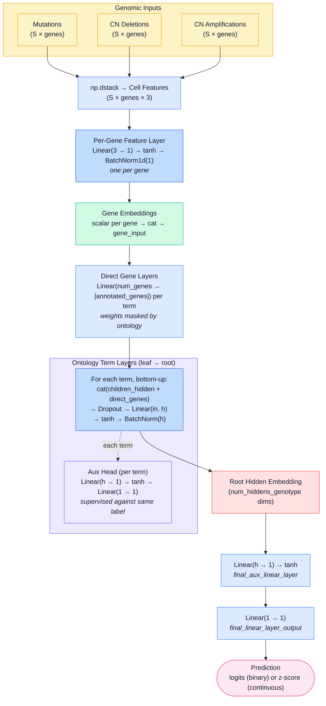
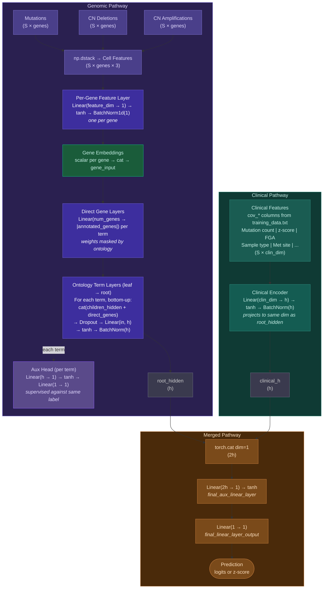

# Model and code reference

This page covers how the network is built, how it is trained, the training flags, the code layout and the input file formats. For what the outputs mean, see [outputs.md](outputs.md).

## How the network is built

`DrugCellNN` in `src/drugcell_nn.py` builds its layers from the ontology at startup. The hierarchy has two kinds of edges: system-to-system edges and gene-to-system annotations.

**Gene layer.** Each gene has one to four binary inputs: mutation, copy-number deletion, copy-number amplification and, optionally, fusion. A small per-gene layer, `Linear(n_features → 1) → tanh → BatchNorm1d`, turns them into one number per gene. Batch normalization keeps one feature type from dominating the others.

**System layers.** Systems are built from the leaves up to the root. Each system takes two inputs:
- the hidden states of its child systems
- the outputs of its direct gene layer

These go through `Dropout → Linear → tanh → BatchNorm` to produce a hidden state of size `-genotype_hiddens` (default 4).

**Ontology constraint.** Each system's direct gene layer is a dense `Linear` over all genes, but only its annotated genes are allowed to have weight. At startup, weights outside each system's gene set are zeroed. After every backward pass, their gradients are zeroed too:

```python
param.grad.data = torch.mul(param.grad.data, term_mask_map[term_name])
```

So a gene can only feed a system it is annotated to. This is what makes a system's activity interpretable as the state of its genes. The masking happens in `vnn_trainer.py`; the weight matrices themselves are not sparse. All weights are also scaled by 0.1 at startup.

**Auxiliary outputs.** Every system has a small output head, `Linear(h → 1) → tanh → Linear(1 → 1)`, trained against the same label as the final output:

```
total_loss = main_loss + alpha * sum(aux_loss over all systems)
```

`alpha` defaults to 0.3. Without these heads, systems far from the root get little gradient and learn little.

**Output.** The root's hidden state goes through `Linear(h → 1) → tanh → Linear(1 → 1)` to give the prediction. The forward pass returns two maps:
- the auxiliary outputs, keyed by system name, with the final prediction under `'final'`
- the hidden states of every system and gene

### Genotype only



### With clinical covariates

Covariates are the `cov_*` columns that `cbioport_transform.py` adds to `training_data.txt`; `TrainingDataWrapper` picks them up automatically. A clinical encoder, `Linear(n_cov → h) → tanh → BatchNorm`, brings them to the same size as the root's hidden state. The two are concatenated before the final layers. The ontology layers never see the covariates.



| Step | Layer | Input | Output |
|---|---|---|---|
| 1 | `np.dstack` of the feature matrices | 3–4 × (S × genes) | S × genes × features |
| 2 | Per-gene `Linear → tanh → BatchNorm` | S × features, per gene | S × 1, per gene |
| 3 | Concatenate gene outputs | | S × genes |
| 4 | Direct gene layer, per system | S × genes | S × annotated genes |
| 5 | System layers, leaves to root | S × (children's h + direct genes) | S × h |
| 5a | Auxiliary head, per system | S × h | S × 1, used only in the loss |
| 6 | Clinical encoder | S × n_cov | S × h |
| 7 | Concatenate root and clinical | S × h, S × h | S × 2h |
| 8 | `Linear(2h → 1) → tanh` | S × 2h | S × 1 |
| 9 | `Linear(1 → 1)` | S × 1 | S × 1 |

S is the batch size and h is `-genotype_hiddens`.

## Binary and continuous tasks

The network is the same for both. Only the loss and the output handling change.

| | Binary (`-task binary`) | Continuous (`-task continuous`) |
|---|---|---|
| Loss (main and auxiliary) | `BCEWithLogitsLoss` | `MSELoss` |
| Label normalization | None, labels stay 0/1 | Set by `-zscore_method`, see below |
| Prediction output | Logits, then sigmoid, then a 0.5 threshold | Normalized predictions, which can be converted back using `std.txt` |
| Reported metric | Accuracy | Pearson correlation |

For continuous labels, `-zscore_method zscore` or `robustz` normalizes them using training-set statistics and saves the parameters to `std.txt`. The default, `auc`, leaves labels as they are, which suits labels already on a common scale. Prediction always reads `std.txt`, so passing `-zscore_method` to `predict.py` has no effect.

The original NeST-VNN used concordance correlation (CCC) as the auxiliary loss for regression. This version uses MSE instead. Early in training the auxiliary heads output nearly constant values, which makes CCC's denominator close to zero and the loss unstable. MSE has no such problem.

## Training

- **Split:** 20% of samples are held out at random for validation; `-seed` makes the split repeatable. There is no separate test split. `run.py` runs prediction on the whole of `training_data.txt`, training samples included.
- **Optimization:** AdamW with gradient clipping (max norm 5.0). Training stops early when validation loss hasn't improved for `-patience` epochs, and the best checkpoint is kept as `model_final.pt`.
- **Hyperparameter search:** `-optimize 2` runs 20 Optuna trials before the final training run.
- **Architecture images:** each run writes `nn_architecture.png` (the actual network, drawn from the ontology) and `nn_schematic.png` (a simplified overview) to the model folder.
- **MLflow:** on by default; `-no_mlflow` turns it off. A run logs the parameters, the per-epoch losses, metric and gradient norm, the best-epoch values, summary metrics for the saved model, confusion matrices for binary tasks, and the model itself with its input and output signature.

### Training flags

| Flag | Default | Meaning |
|---|---|---|
| `-task` | `continuous` | `binary` or `continuous` |
| `-label` | none | Column of `training_data.txt` to predict |
| `-genotype_hiddens` | `4` | Hidden units per system; the annotation step reads it from the hidden files |
| `-optimize` | `1` | `1` trains directly; `2` runs an Optuna search first |
| `-alpha` | `0.3` | Weight of the auxiliary losses |
| `-epoch` | `300` | Maximum epochs (`run.py` suggests 200) |
| `-lr` | `0.001` | AdamW learning rate |
| `-wd` | `0.001` | AdamW weight decay |
| `-patience` | `30` | Epochs without improvement before stopping |
| `-dropout_fraction` | `0.3` | Dropout on system layers |
| `-min_dropout_layer` | `2` | First layer, counting from the leaves, that gets dropout |
| `-zscore_method` | `auc` | Label normalization for training: `auc` (none), `zscore` or `robustz` |
| `-cuda` | `0` | GPU index, or `cpu` |
| `-seed` | none | Seed for the train/validation split |
| `-no_mlflow` | off | Turn off MLflow tracking |

## Code layout

`src/`:

| File | Role |
|---|---|
| `drugcell_nn.py` | The network |
| `training_data_wrapper.py` | Loads the ontology, checks it has one root and is connected, maps genes to systems, stacks the feature matrices and reads the `cov_*` columns |
| `vnn_trainer.py` | Training loop, gradient masking, early stopping, MLflow logging, architecture images |
| `optuna_nn_trainer.py` | Optuna search, built on `VNNTrainer` |
| `train.py` | Command-line entry point for training |
| `predict.py` | Loads a model and writes predictions, hidden states and gradients |
| `annotate_hierarchy.py` | RLIPP, gene scores, subsystem weights, logic gates, per-patient scores and the HTML viewers |
| `rlipp_calculator.py`, `rlipp_helper.py` | Older RLIPP code that groups results by drug, for the GDSC sample data |
| `util.py` | Data loading, label normalization, gene masks and correlation metrics |

`scripts/`:

| File | Role |
|---|---|
| `cbioport_download.py` | Downloads mutations, copy number, fusions and clinical data for a cBioPortal study |
| `cbioport_transform.py` | Builds the model inputs: you choose the endpoint, the gene panel (by mutation frequency, or from an NDEx hierarchy) and the covariates |
| `run.py` | Interactive launcher for all of the above |

When an NDEx hierarchy is used, systems with fewer than 5 panel genes (the default, as in the paper) are removed. Their genes move up to the nearest remaining parent.

## Input files

All of these live in `data/output/<study_id>/nest_vnn_input/`.

| File | Format | Contents |
|---|---|---|
| `ontology.txt` | TSV: `parent child relation` | `relation` is `default` for a system-to-system edge, `gene` for a gene annotation |
| `cell2ind.txt` | TSV: `index sample_id` | Sets the row order of the feature matrices |
| `gene2ind.txt` | TSV: `index gene_symbol` | Sets the column order of the feature matrices |
| `cell2mutation.txt`, `cell2cndeletion.txt`, `cell2cnamplification.txt`, `cell2fusion.txt` | CSV of 0/1 | Samples × genes |
| `training_data.txt` | TSV with header | `cell_line`, one or more label columns, any `cov_*` columns, and `dataset`. The older headerless format is `cell_line smiles auc dataset`. |
| `endpoints.json` | JSON | Whether each label is binary or continuous; `run.py` uses it to pick the task |
| `covariate_stats.json` | JSON | How each `cov_*` column was encoded (mean and std for numeric columns, a value map for categorical ones), so values can be shown in readable form |
| `metadata.json` | JSON | The cBioPortal study and NDEx network the inputs came from |
